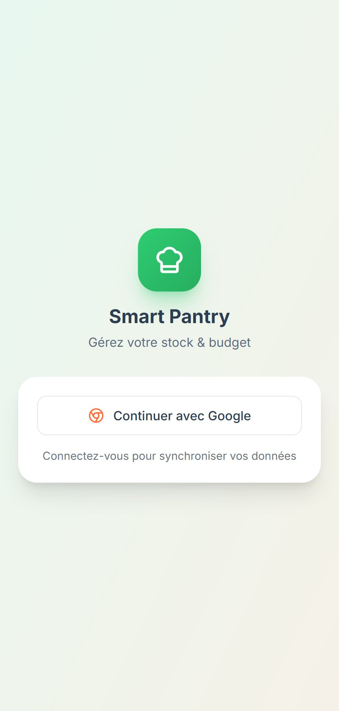

# Smart Pantry & Budget — anti-gaspillage alimentaire

**▶ App en ligne : [smartpantry.be](https://smartpantry.be)** (connexion Google)
Par [John Dossin](https://dossin.rvlts.com) · portfolio complet : [dossin.rvlts.com](https://dossin.rvlts.com)

Suivre son garde-manger, recevoir des **menus de la semaine générés par IA** à partir de ce qu'on a déjà, construire sa liste de courses et être **prévenu avant les dates de péremption**. Web mobile-first + app Android native, entièrement en français.

> ℹ️ Ce dépôt est une **vitrine** : le code source est privé (comptes utilisateurs). Accès en lecture sur demande pour un entretien — dossinjohn@gmail.com.

## Fonctionnalités

- **Inventaire** du garde-manger, avec **scan de code-barres** (fiche produit via OpenFoodFacts).
- **Analyse par photo et par la voix** : ajouter des produits ou un ticket de caisse sans tout saisir.
- **Menus hebdomadaires générés par IA** à partir du stock réel.
- **Liste de courses** et **notifications de péremption** (scan automatique de l'inventaire toutes les 24 h).
- **Freemium** : 3 générations IA pour les comptes gratuits, illimité en premium.

## Décisions d'ingénierie

- **La clé IA ne quitte jamais le serveur** — le front n'appelle jamais Google directement : tout passe par un proxy Express qui injecte la clé.
- **Liste blanche des modèles côté serveur** — seuls les modèles autorisés passent (HTTP 400 sinon) : un client modifié ne peut pas appeler un modèle plus cher.
- **Limitation de débit** — 30 requêtes/min sur l'API, 10/min sur l'IA : la facture IA reste bornée.
- **Deux clients, un seul projet Firebase** — web React et Android natif (Kotlin/Compose) partagent l'authentification et les comptes.

## Stack

| Couche | Technologies |
|---|---|
| Web | React 19 · TypeScript strict · Vite · Tailwind · Framer Motion |
| API | Express · proxy IA · express-rate-limit |
| Données | Firebase Auth (Google) · Firestore · OpenFoodFacts |
| IA | Gemini (flash pour image/voix/ticket, pro pour les menus) |
| Mobile | Android Kotlin / Jetpack Compose |
| Exploitation | VPS administré par moi · nginx · TLS |

## Ce que je referais autrement

L'inventaire est aujourd'hui stocké **sur l'appareil** (stockage local du navigateur) : simple et rapide, mais pas synchronisé entre appareils. La prochaine étape serait de le rattacher au compte (Firestore) pour retrouver son garde-manger partout.
